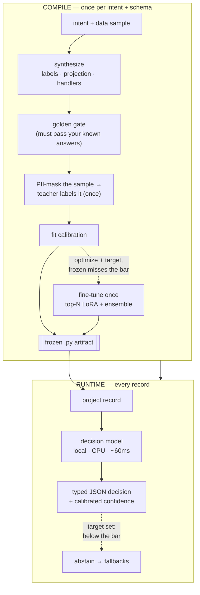

# STROT

### The open decision system

**Compile System 2 reasoning into System 1 decisions — $0 at inference.**

**LOW LATENCY · ULTRAFAST · CHEAP & FREE · 0 TOKENS · LOW CARBON · CPU INFERENCE ONLY**

[](https://pypi.org/project/strot-ai/)
[](LICENSE)
[](pyproject.toml)
[](https://huggingface.co/spaces/STROT-ai/STROT-AI-Compiler)

**▶ [Try the live demo](https://huggingface.co/spaces/STROT-ai/STROT-AI-Compiler)** — decisions in your browser, no install, key-free.

An LLM reasons through your task once, at compile time. Every decision after runs
on a small local model on **CPU** — no API calls, no GPU, no per-record cost:
**faster, cheaper, and a fraction of the energy** of calling an LLM on every record.

STROT compiles a decision task into a standalone pipeline. You describe the
intent once (a query plus the set of actions it can take), an LLM compiles that
into a frozen Python artifact, and from then on a small local model makes the
actual decisions — on CPU, no API calls at runtime, bounded typed-JSON output.

I built it because getting a small local model to reliably *decide* things
(route this ticket, classify this text, score this record) is fiddly work, and
accuracy swings hard depending on how you phrase the labels. STROT moves that
work to compile time and freezes the result, the way a compiler moves work off
the hot path.

```bash
pip install strot-ai
```

```python
import strot

result = strot.run(
    tickets,
    query="Triage incoming support tickets into the correct workflow.",
    action_registry={
        "billing_dispute":  "Refunds, invoice corrections, double charges",
        "technical_defect": "Crashes, bugs, broken behavior",
    },
    llm="anthropic/claude-opus-4-8",   # used once, on first compile only
)

for o in result.outcomes:
    print(o["action"], round(o["confidence"], 2))
# billing_dispute 0.97
# technical_defect 0.94
```

The LLM runs once, when the artifact is first compiled. After that, production
is a self-contained Python file: a small local model arbitrates every record,
nothing is generated at runtime, and every output is bounded and carries a
calibrated confidence. By default it dispatches every record and lets you decide
what to do with the low-confidence tail; set an accuracy or risk target and it
abstains on records below the bar instead of guessing.

To compile with a subscription CLI, use
`llm="claude-cli/claude-opus-4-8"` or `llm="codex-cli/gpt-6-luna"`.
Sign in through `claude` or `codex login` first. Omit `/<model>` to use the
CLI default. Model access and usage limits depend on your account.
The CLI only runs at compile time. See [the example](examples/end_to_end.py).
For a CLI outside PATH, pass a client such as
`llm=strot.codex_cli_llm_client(cli="/path/to/codex", model="gpt-6-luna")`.
For Claude, use `llm=strot.claude_cli_llm_client(cli="/path/to/claude")`.

## How it works

Two phases. The expensive, nondeterministic one happens once; the cheap one runs
on every record forever.



The compiler doesn't trust its first guess at the labels. It scores candidate
labelings against a teacher-labeled sample and keeps whichever one actually
measures best, and refuses to promote an artifact that fails your golden
records. By default the battery dispatches every record with a calibrated
confidence; give it an accuracy or risk target and it also fits the threshold
that decides which records to abstain on.

## Two ways to use it

`run()` routes each record to an action and executes the compiled handler:

```python
result = strot.run(records, query=..., action_registry={...}, llm=...)
```

`decide()` answers typed questions per record (choice / score / boolean):

```python
result = strot.decide(records, questions={
    "is_bug_report":      {"type": "boolean", "instructions": "mentions crashes/errors?"},
    "customer_sentiment": {"type": "score", "min": 1, "max": 5, "instructions": "1 angry, 5 happy"},
    "routing_bucket":     {"type": "choice", "options": ["billing", "engineering", "spam"]},
})
# {"booleans": {...}, "scores": {...}, "choices": {...}}  with probabilities + confidence
```

## Where it fits

STROT is built for record-level decisions on messy real text — the kind cyber,
financial, and insurance triage actually run on. Easy tasks (routing,
tool-selection) stay on the frozen tier and never need more. Harder,
representation-bound tasks — where the right call hinges on a distinction a small
frozen encoder can't see on its own — are what the opt-in fine-tune tier is for.

The product metric isn't blanket accuracy; it's reliability on the slice the
model is confident about (coverage at your target). Calibration and the
fine-tune ensemble are what move that slice. For production-grade accuracy on a
specific domain, drop a task-trained specialist into the `nlu=` slot — the
compiler, calibration, and gate don't change.

Runtime cost is the point: every decision runs locally on CPU, in tens of
milliseconds, at $0 and zero LLM calls.

## What's actually going on under the hood

- The optimizer compiles once; the battery decides forever. The compiled
  artifact is content-addressed; a schema change triggers exactly one recompile,
  nothing else does. There is no runtime loop: compile is a single pass, and the
  battery never retrains itself. Each battery lands on disk as
  `battery_<task>_<hash>.py` and carries all its task-specific parameters inline
  — routing labels, calibration, the distilled head, and (the fine-tune tier)
  the LoRA weights — so the only external dependency is the shared base-model
  checkpoint it loads at runtime. Pass `name=` to label the file; otherwise the
  slug is derived from your query.
- Cheapest tier that clears your bar. The optimizer keeps the cheapest rung that
  meets your target on held-out real records: a zero-shot route, then a logistic
  head distilled onto the frozen encoder. Both are frozen tiers and cover most
  tasks — routing and tool-selection rarely leave them.
- Fine-tune once, opt-in. For representation-bound tasks the frozen tiers can't
  crack, pass `optimize=True` together with a target (`target_accuracy` or
  `target_risk`). Only when the frozen tier misses that target on the real
  measurement fold does the compiler fine-tune — once — a light cached-lower +
  top-N LoRA on ModernBERT (the `[finetune]` extra). It trains a small K=3
  ensemble of diverse adapters and averages them at inference; the measured
  winner is kept. Without a target, `optimize=True` is a no-op. Already built an
  adapter? Pass it as `reuse_adapter=` to adopt it after a quick validation on
  this task's fold and skip training entirely.
- No abstention by default; abstention is opt-in. With no target set the battery
  never hard-abstains: it dispatches every record and publishes the confidence
  (calibrated if a threshold was fitted), and the caller decides what to do with
  the low-confidence tail. Set `target_risk` (split conformal) or
  `target_accuracy` (an empirical dispatch cutoff) and the battery starts
  abstaining on records below the bar. Abstained records come back in
  `result.fallbacks` for you to re-run however you like — STROT does not loop.
- Golden records are a promotion gate, not a hint. A battery that fails your
  known answers never serves.
- Calibration is temperature scaling plus split conformal prediction, fitted at
  compile time. When a target is set, dispatched decisions are wrong at most α of
  all records (marginal), and the confident slice — coverage at your target — is
  the product metric, not blanket accuracy.
- Nothing is generated at runtime. Output is selection and computation over your
  registry, so there's no structural hallucination to guard against.
- The decision model is a slot (`nlu=`): local Julia-1 zero-shot by default,
  ModernBERT for the fine-tune tier, a hosted API, or any specialist you drop in.

### Data

The teacher LLM is used as a labeler of real records (distillation), never as a
bulk synthetic generator. Before any record reaches the teacher it is PII-
masked at that boundary. GLiNER is the default masker for names, addresses, and
orgs (it needs the `[pii]` extra); a thin regex pre-pass runs ahead of it to
guard format-defined tokens (email, SSN, Luhn card, API keys, IBAN, IP/MAC/
phone). Without the `[pii]` extra it falls back to regex-only with a warning.
Masking is compile-time only.

Synthetic data is a last resort, not a default. We measured it, and LLM-generated
synthetic records hurt both accuracy and the confident slice — they come out too
clean and tend to leak the label. So the policy is real-first: label real data,
and handle class imbalance by pulling and
labeling more real minority-class records (or oversampling / weighting the real
minority). Reach for synthetic only to seed a near-empty class, never to "scale
up."

## Install

```bash
pip install strot-ai             # core: pure stdlib
pip install "strot-ai[local]"     # + local model dependencies (torch/transformers)
pip install "strot-ai[finetune]"  # + torch/transformers, for the opt-in fine-tune tier
pip install "strot-ai[pii]"       # + GLiNER NER masking at the teacher boundary
pip install "strot-ai[hosted]"    # + openai, for API synthesis or runtime routing
pip install "strot-ai[anthropic]" # + anthropic, for Anthropic API synthesis
```

Extras install optional Python packages. They do not select a provider or sign you in.
For OpenAI API synthesis, install `[hosted]`, set `OPENAI_API_KEY`, and pass
`llm="openai/gpt-4o"`. For Anthropic API synthesis, install `[anthropic]`, set
`ANTHROPIC_API_KEY`, and pass `llm="anthropic/claude-opus-4-8"`.
Subscription CLI synthesis needs the CLI and its subscription login. It needs
neither the `[hosted]` nor the `[anthropic]` extra. Check which login the CLI uses.
Other credentials can override a saved subscription login.

Bake the local model into your image for offline production:

```dockerfile
RUN pip install strot-ai[local] \
 && python -c "import strot; strot.prefetch_nlu(local_dir='/opt/julia-1', install=True)"
ENV STROT_NLU_CHECKPOINT=/opt/julia-1
```

(`julia` on PyPI is an unrelated package — don't install it. The decision
model's inference code is pulled from its Hugging Face repo by `prefetch_nlu`.)

## Docs

[DEVELOPERS.md](DEVELOPERS.md) covers the architecture, the compile lifecycle,
calibration semantics and their caveats, deployment, model swapping, and the
full API.

## Contributing & contact

Contributions are welcome — keep pull requests focused on one change, branch off
the latest `main`, and run the test suite first. See [CONTRIBUTING.md](CONTRIBUTING.md).

Questions, ideas, or problems: open an issue or email **lee@strot-ai.xyz**.

Built by Amit Rath. Follow me on [LinkedIn](https://www.linkedin.com/in/amirath/).

## License

MIT. The default decision model is Apache-2.0
([SupersonicLabs/Julia-1](https://huggingface.co/SupersonicLabs/Julia-1)).
Implements ideas from STROT (arXiv:2505.01636).
