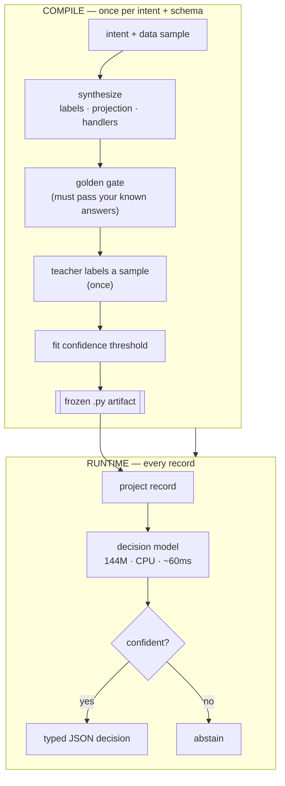

# STROT

### The open decision system

**Compile System 2 reasoning into System 1 decisions — $0 at inference.**

**LOW LATENCY · ULTRAFAST · CHEAP & FREE · 0 TOKENS · LOW CARBON · CPU INFERENCE ONLY**

[](https://pypi.org/project/strot-ai/)
[](LICENSE)
[](pyproject.toml)
[](https://huggingface.co/spaces/STROT-ai/STROT-AI-Compiler)

**▶ [Try the live demo](https://huggingface.co/spaces/STROT-ai/STROT-AI-Compiler)** — decisions in your browser, no install, key-free.

An LLM reasons through your task once, at compile time. Every decision after runs
on a small local model on **CPU** — no API calls, no GPU, no per-record cost:
**faster, cheaper, and a fraction of the energy** of calling an LLM on every record.

STROT compiles a decision task into a standalone pipeline. You describe the
intent once (a query plus the set of actions it can take), an LLM compiles that
into a frozen Python artifact, and from then on a small local model makes the
actual decisions — on CPU, no API calls at runtime, bounded typed-JSON output.

I built it because getting a small local model to reliably *decide* things
(route this ticket, classify this text, score this record) is fiddly work, and
accuracy swings hard depending on how you phrase the labels. STROT moves that
work to compile time and freezes the result, the way a compiler moves work off
the hot path.

```bash
pip install strot-ai
```

```python
import strot

result = strot.run(
    tickets,
    query="Triage incoming support tickets into the correct workflow.",
    action_registry={
        "billing_dispute":  "Refunds, invoice corrections, double charges",
        "technical_defect": "Crashes, bugs, broken behavior",
    },
    llm="anthropic/claude-haiku-5-5",   # used once, on first compile only
)

for o in result.outcomes:
    print(o["action"], round(o["confidence"], 2))
# billing_dispute 0.97
# technical_defect 0.94
```

The LLM runs once, when the artifact is first compiled. After that, production
is a self-contained Python file: a small local model arbitrates every record,
nothing is generated at runtime, every output is bounded, and records the model
isn't sure about abstain instead of guessing.

To compile with a subscription CLI, use
`llm="claude-cli/claude-haiku-5-5"` or `llm="codex-cli/gpt-6-luna"`.
Sign in through `claude` or `codex login` first. Omit `/<model>` to use the
CLI default. Model access and usage limits depend on your account.
The CLI only runs at compile time. See [the example](examples/end_to_end.py).
For a CLI outside PATH, pass a client such as
`llm=strot.codex_cli_llm_client(cli="/path/to/codex", model="gpt-6-luna")`.
For Claude, use `llm=strot.claude_cli_llm_client(cli="/path/to/claude")`.

## How it works

Two phases. The expensive, nondeterministic one happens once; the cheap one runs
on every record forever.



The compiler doesn't trust its first guess at the labels. It scores candidate
labelings against a teacher-labeled sample and keeps whichever one actually
measures best, fits a calibration threshold so low-confidence records can
abstain, and refuses to promote an artifact that fails your golden records.

## Two ways to use it

`run()` routes each record to an action and executes the compiled handler:

```python
result = strot.run(records, query=..., action_registry={...}, llm=...)
```

`decide()` answers typed questions per record (choice / score / boolean):

```python
result = strot.decide(records, questions={
    "is_bug_report":      {"type": "boolean", "instructions": "mentions crashes/errors?"},
    "customer_sentiment": {"type": "score", "min": 1, "max": 5, "instructions": "1 angry, 5 happy"},
    "routing_bucket":     {"type": "choice", "options": ["billing", "engineering", "spam"]},
})
# {"booleans": {...}, "scores": {...}, "choices": {...}}  with probabilities + confidence
```

## Numbers

Real model (SupersonicLabs/Julia-1, 144M, CPU), real datasets, run in clean
Docker containers. The benchmark scripts are in [`benchmarks/`](benchmarks/),
losses included.

The routing, semantic-text, and risk benchmarks used Claude Opus 4.8 for
synthesis. Those results do not measure the new Haiku 5.5 default.

| Benchmark | Result |
|---|---|
| Grounded routing (398 records) | 92.5% compiled vs 74.8% naive — the compiler is worth +18pp on the same model |
| Semantic text, unseen labels (AG News) | 86.7% compiled vs 72.7% naive (+14pp) |
| Typed decisions vs a leading hosted decision API's own example | near-identical (sentiment 1.79 vs 1.8) |
| Latency / marginal cost / LLM calls per record | ~60ms · $0 · 0 |

### On real risk narratives

Record-level unstructured text, the kind cyber / financial / insurance triage
actually runs on. Public ground-truth datasets, classes balanced so accuracy is
interpretable, baselines shown. STROT never sees the test labels.
([`benchmarks/risk_narratives.py`](benchmarks/risk_narratives.py))

| Task — 6-class, balanced | Random | Majority | Naive | Compiled | Abstains |
|---|---|---|---|---|---|
| Cyber — [VERIS/VCDB](https://github.com/vz-risk/VCDB) incident note → attack action | 16.7% | 16.7% | 36.8% | 39.5% | 8/114 |
| Finance — [CFPB](https://www.consumerfinance.gov/data-research/consumer-complaints/) complaint → product | 16.7% | 26.4% | 54.2% | 61.1% | 5/72 |

Both clear their baselines and the compiler lifts accuracy on the same 144M
model, with low-confidence records abstaining. These are honest proof the
architecture works on messy real text, not production underwriting accuracy. For
that you'd put a task-trained specialist in the `nlu=` slot; the compiler,
calibration, and gate don't change.

## What's actually going on under the hood

- Compile once, decide forever. Artifacts are content-addressed; a schema change
  triggers exactly one recompile, nothing else does.
- Golden records are a promotion gate, not a hint. An artifact that fails your
  known answers never serves.
- Calibration is temperature scaling plus split conformal prediction, fitted at
  compile time. Dispatched decisions are wrong at most α of all records
  (marginal); the rest abstain.
- Nothing is generated at runtime. Output is selection and computation over your
  registry, so there's no structural hallucination to guard against.
- The decision model is a slot (`nlu=`): local Julia-1 by default, a hosted API,
  or any specialist you drop in.

## Install

```bash
pip install strot-ai             # core: pure stdlib
pip install "strot-ai[local]"     # + local model dependencies (torch/transformers)
pip install "strot-ai[hosted]"    # + openai, for API synthesis or runtime routing
pip install "strot-ai[anthropic]" # + anthropic, for Anthropic API synthesis
pip install "strot-ai[codex-sdk]" # + Codex Python SDK and its bundled runtime
```

Extras install optional Python packages. They do not select a provider or sign you in.
For OpenAI API synthesis, install `[hosted]`, set `OPENAI_API_KEY`, and pass
`llm="openai/gpt-6-luna"`. For Anthropic API synthesis, install `[anthropic]`, set
`ANTHROPIC_API_KEY`, and pass `llm="anthropic/claude-haiku-5-5"`.
Subscription CLI synthesis needs the CLI and its subscription login. It needs
neither the `[hosted]` nor the `[anthropic]` extra. Check which login the CLI uses.
Other credentials can override a saved subscription login.

For Codex SDK synthesis, install `[codex-sdk]` and pass
`llm="codex-sdk/gpt-6-luna"`. It reuses your Codex login and prefers a verified installed CLI.
With uv, run in a virtual environment:

```bash
uv pip install "strot-ai[codex-sdk]"  # With the bundled CLI

# Or reuse codex CLI from PATH or bundled in the ChatGPT desktop app:
printf 'openai-codex-cli-bin\n' |
  uv pip install --excludes - "strot-ai[codex-sdk]"
```

Repeat the exclusion for upgrades. See [client configuration](DEVELOPERS.md#llm-clients)
for CLI selection, callbacks, and reasoning effort.

Bake the local model into your image for offline production:

```dockerfile
RUN pip install strot-ai[local] \
 && python -c "import strot; strot.prefetch_nlu(local_dir='/opt/julia-1', install=True)"
ENV STROT_NLU_CHECKPOINT=/opt/julia-1
```

(`julia` on PyPI is an unrelated package — don't install it. The decision
model's inference code is pulled from its Hugging Face repo by `prefetch_nlu`.)

## Docs

[DEVELOPERS.md](DEVELOPERS.md) covers the architecture, the compile lifecycle,
calibration semantics and their caveats, deployment, model swapping, and the
full API.

## Contributing & contact

Contributions are welcome — keep pull requests focused on one change, branch off
the latest `main`, and run the test suite first. See [CONTRIBUTING.md](CONTRIBUTING.md).

Questions, ideas, or problems: open an issue or email **lee@strot-ai.xyz**.

## License

MIT. The default decision model is Apache-2.0
([SupersonicLabs/Julia-1](https://huggingface.co/SupersonicLabs/Julia-1)).
Implements ideas from STROT (arXiv:2505.01636).
